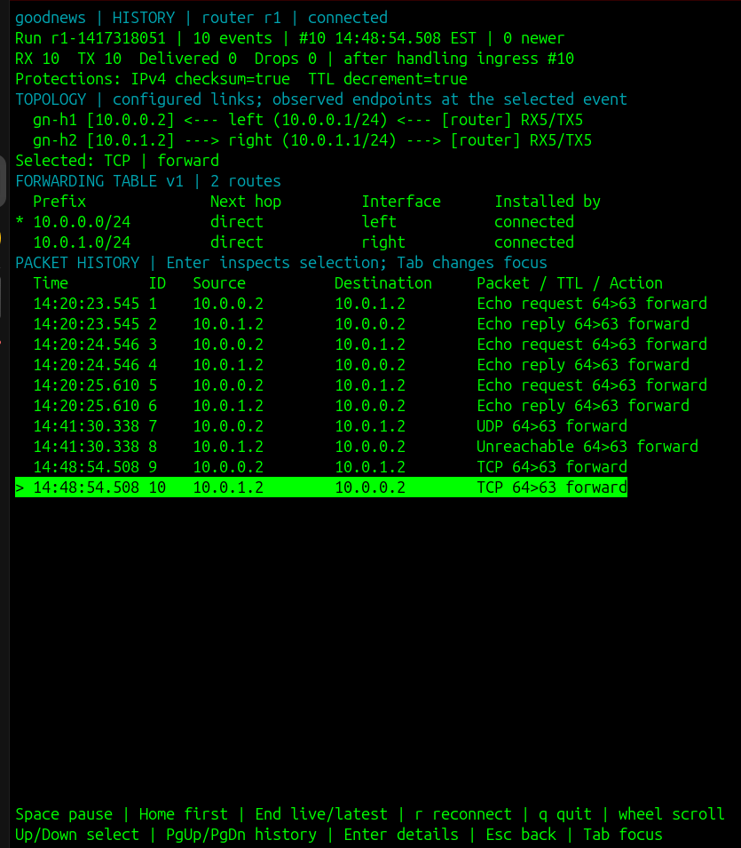

# goodnews

A small IPv4 router for learning the network and control planes in Kurose and
Ross. Stage 1 implements forwarding over Linux TUN devices. Ethernet, ARP,
distributed routing, fragmentation, NAT, and a controller are later stages.

The router owns its addresses in Go. It does not assign them to kernel
interfaces. The lab disables kernel forwarding, and traffic stops when the
process stops.



Browse packet history alongside topology, counters, and the forwarding table.
See the [dashboard guide](docs/dashboard.md) to run it yourself.

## Build and check

Use Linux and Go 1.27.3. The only module dependency is `golang.org/x/sys`.
The race detector needs a C compiler. On Ubuntu, install Go and the lab tools with:

```sh
sudo apt-get update
sudo apt-get install golang-go build-essential iproute2 procps ethtool iputils-ping traceroute tcpdump python3
```

The apt package may bundle an older Go version. `GOTOOLCHAIN=auto` lets Go
download the version selected by this project on first use. Alternatively,
install Go using the [official instructions](https://go.dev/doc/install).

```sh
env GOTOOLCHAIN=auto make build
env GOTOOLCHAIN=auto make check
env GOTOOLCHAIN=auto make fuzz
./bin/goodnews check --config lab/stage1.json
```

`check` validates configuration without opening interfaces or requiring root.
If make is unavailable, use `go build -o bin/goodnews ./cmd/goodnews`,
`go test -race . ./cmd/... ./drivers/... ./internal/...`, and
`go vet . ./cmd/... ./drivers/... ./internal/...` directly. These patterns keep Go from
entering private, root-owned lab captures under `artifacts/`.

## Run the first lab

Follow the [Stage 1 lab guide](docs/stage1.md) for setup, commands explained in
context, expected results, captures, configuration experiments, and cleanup.
It identifies which commands run in each terminal. The commands below are a
quick reference for returning sessions.

The guides support both Fish and Bash. Shared command blocks work in either
shell, and prompts have separately labeled Fish and Bash versions. Fish users
can stay in Fish throughout the lab.

Use a Linux host with network namespace support, `/dev/net/tun`, and sudo.
Setup needs `CAP_NET_ADMIN` and namespace switching needs `CAP_SYS_ADMIN`;
packet crafting needs `CAP_NET_RAW`. The supplied scripts run as root rather
than granting capabilities permanently to the binary.

```sh
make lab-up
sudo ip netns exec gn-r1 ./bin/goodnews run --config lab/stage1.json
```

In another terminal:

```sh
sudo ip netns exec gn-h1 ping -c 3 10.0.0.1
sudo ip netns exec gn-h1 ping -c 3 10.0.1.2
sudo ip netns exec gn-h1 traceroute -n 10.0.1.2
sudo ./bin/goodnews show routes --socket /run/goodnews-lab-stage1/r1.sock
sudo ./bin/goodnews show counters --socket /run/goodnews-lab-stage1/r1.sock --json
```

Stop the router with Ctrl-C, then run `make lab-down`. Cleanup refuses to remove
namespaces with running processes or namespaces whose recorded identity changed.
Run commands from the repository root; relative output paths follow the current
working directory.

```text
gn-h1                            gn-r1                           gn-h2
10.0.0.2/24 -- TUN fd --> goodnews (.1 addresses in Go) <-- TUN fd -- 10.0.1.2/24
```

Both TUN devices are called `gn0`, each inside its own host namespace. A TUN
is not a veth cable: host transmission becomes a read from its file descriptor;
writing to that descriptor injects a packet into the host's receive path.
`goodnews` temporarily enters each host namespace to attach its descriptor,
restores the router namespace, and then starts packet workers. There are no
kernel data-plane interfaces in `gn-r1` apart from loopback in this stage.

The lab changes only its three namespaces. NetworkManager cannot manage these
namespace-local interfaces. No host addresses, forwarding settings, routes,
firewalls, or NetworkManager profiles are modified. A missing TUN device or
denied namespace operation means this lab needs to run on a suitably privileged
Ubuntu host; setup fails with a diagnostic.

## Inspect packets

For a combined live view with scrollback, see the
[terminal dashboard guide](docs/dashboard.md). It shows topology, counters,
forwarding tables, packet decisions, and historical state:

```sh
sudo ./bin/goodnews dashboard --config lab/stage1.json
```

Rebuild and restart the router first so it writes the new history metadata.
To try the interface without a running lab or sudo:

```sh
./bin/goodnews dashboard --run internal/dashboard/testdata/demo
```

Arrow keys/Page Up/Page Down browse history, Enter opens details, End resumes
following, and `q` quits. These commands work in Fish and Bash. Open saved runs
with `--run DIR`; unrecorded historical state is labeled unavailable.
Live attachment discovers the run directory automatically.

Each run prints a fresh directory under `artifacts/runs`. It contains:

- `trace.jsonl`: one terminal decision per received packet, plus generated-packet
  records linked by `parent_id`.
- `counters.jsonl`: snapshots after each processed packet.
- `run.json`: startup identity, interfaces, and effective protections.
- `fib.jsonl`: the initial forwarding table and each version used by a packet.
- `left.pcap` and `right.pcap`: raw IPv4 packets received and successfully sent.

Decode private pcaps with `sudo cat FILE | tcpdump -nn -r -`, or copy them to
a location you can read before opening them in Wireshark. Streaming an already
opened file avoids tcpdump's privilege dropping and pathname restrictions.
Capture files include both directions; use addresses and timestamps to correlate
them with the trace. The trace includes the FIB version and every matching route in
longest-prefix-first order. Generated replies have their own IDs and routes.

The read-only HTTP API runs on an owner-only Unix socket. `show` supports
`interfaces`, `routes`, and `counters`; `arp`, `neighbors`, and `lsdb` explicitly
report that they are not enabled in Stage 1. Without `--json`, output is
indented JSON. The interface view shows effective protection settings.

Drops include rejected incoming packets and failed generated packets. For
example, an expired incoming packet and a failed attempt to send its ICMP error
count as two drops. Unsupported traffic has a named reason. Link send errors
are traced and counted; capture/export failures stop the router.

## Craft a packet

For successful UDP and HTTP exchanges, follow the [traffic guide](docs/traffic.md).
It includes a UDP echo server/client, a web server, and commands for comparing
application errors with router errors. `left` and `right` are bidirectional
router interfaces, separate from UDP/TCP application port numbers.

Crafting uses AF_PACKET on the host TUN, avoiding the AF_INET path that repairs
IPv4 checksums. This keeps corruption visible to the router.

```sh
sudo ip netns exec gn-h1 ./bin/goodnews craft --interface gn0 --bad-checksum
sudo ip netns exec gn-h1 ./bin/goodnews craft --interface gn0 --ttl 1
sudo ip netns exec gn-h1 ./bin/goodnews craft --interface gn0 --dst 192.0.2.1
sudo ip netns exec gn-h1 ./bin/goodnews craft --interface gn0 --version 6
sudo ip netns exec gn-h1 ./bin/goodnews craft --interface gn0 --protocol udp
./bin/goodnews craft --output /tmp/echo.ip
./bin/goodnews craft -h
```

`craft` sends one packet and exits without waiting for a reply. UDP defaults to
`10.0.0.2:40000` → `10.0.1.2:33434`, with a 32-byte payload. With no receiving
application on h2's destination port, expect an ICMP Port Unreachable in the
dashboard. The command itself is silent on successful transmission.

For protection experiments, edit a copy of the configuration and restart the
router. Set `protections.verify_ipv4_checksum` or `protections.decrement_ttl`
to false. Omitted switches default to true. Length checks always remain active.

## Fault experiments and badnews

`badnews` is planned for Stage 2 and is not part of the current build. Stage 1
already supports malformed-packet, TTL, missing-route, protection-switch and
router-outage experiments through `goodnews craft`, config copies and router
restarts. Follow the [Stage 1 fault exercises](docs/stage1-experiments.md#stage-1-faults-and-badnews)
for commands and expected dashboard results. Runtime delay/loss/link controls
remain future work; routing-cost experiments apply when Stage 4 adds routing
protocols.

## Full acceptance check

```sh
make integration
```

This creates its own lab, runs bidirectional ping and traceroute, checks captured
TTL/checksums, sends malformed packets, tests ICMP suppression and MTU behavior,
proves the stopped-router condition, tests both protection switches, and repeats
setup/teardown. It refuses an existing lab. Evidence is retained under
`artifacts/stage1-*`, including configurations, logs, traces, captures, and a
result file only on success. Run it after changes or when verifying the whole
stage. For an interactive session, start with `make lab-up`; acceptance is not
a prerequisite for each session. Stop the router and run `make lab-down` before
starting acceptance so it can create its own lab.

See [the hands-on lab guide](docs/stage1.md) for step-by-step experiments,
[the verification record](docs/verification.md) for what has actually run, and
[the original project plan](software-router-project-plan.md) for later stages.
The separate PostgreSQL acceptance example is in [lab/postgres.sql](lab/postgres.sql).

Stage 1 forwards existing fragments but does not create fragments or reassemble
local traffic. It rejects IP options, broadcast, and multicast. Oversized DF
packets receive ICMP fragmentation-needed with the configured MTU; oversized
non-DF packets are counted as `fragmentation_not_implemented`.
