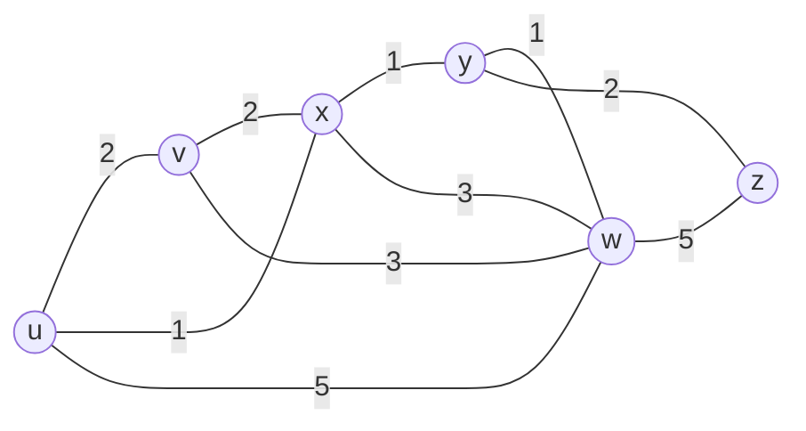

# Stage 4: routing protocols over virtual cables

Run six goodnews processes in Linux namespaces and watch them discover routes.
Choose distance vector (`dv`, Bellman–Ford) or link state (`ls`, Dijkstra).
Neither mode needs physical Ethernet, Wi-Fi forwarding, VMs, or more computers.
Stage 3's physical acceptance remains pending and independent.

This stage teaches algorithms using a custom protocol, with no standard RIP or
OSPF peering. Planned [Stage 7 adds RIPv2/OSPFv2 interoperability, Stage 8 BGP,
and Stage 9 Wi-Fi](future-stages.md). All standard routing-protocol labs can
start with virtual Ethernet; Wi-Fi has its own later radio acceptance gate.

The implementation has automated algorithm, protocol, runtime, and lifecycle
tests. Real namespace acceptance is a separate gate; see
[verification.md](verification.md) for what has actually run.

## Start with distance vector

Use the Linux/Go prerequisites in the README, plus sudo permission to create
network namespaces and raw sockets. Run commands from the repository root.
All shared command blocks work in Bash and Fish. Setup owns only its namespaces
and refuses existing resources; it does not change the host's Internet/Wi-Fi,
routes, forwarding setting, NetworkManager, or firewall.

```sh
make lab4-up ALGORITHM=dv
make lab4-start
make lab4-check
```

Setup creates six router namespaces (`gn4-u` through `gn4-z`) and six endpoint
namespaces (`gn4-h-u` through `gn4-h-z`). `lab4-start` launches the six router
processes, records their identities, and returns to your terminal. Give them a
few seconds to exchange hellos and vectors. No graph-wide static routes are
installed in goodnews.

The ten virtual cables have these costs:



Each router also has a passive host LAN:

| Router | Endpoint namespace | Endpoint address | Logical router address |
| --- | --- | --- | --- |
| u | gn4-h-u | 10.45.0.2/24 | 10.45.0.1 |
| v | gn4-h-v | 10.45.1.2/24 | 10.45.1.1 |
| w | gn4-h-w | 10.45.2.2/24 | 10.45.2.1 |
| x | gn4-h-x | 10.45.3.2/24 | 10.45.3.1 |
| y | gn4-h-y | 10.45.4.2/24 | 10.45.4.1 |
| z | gn4-h-z | 10.45.5.2/24 | 10.45.5.1 |

Transit links use distinct /30 subnets from `10.44.0.0/16`. Setup rejects
conflicting host routes. Router interfaces have no kernel IP addresses and
kernel forwarding is disabled in all twelve namespaces. The `.1` addresses
belong to Go; endpoint kernels use them as gateways through normal ARP.

For full forwarding tables, router switching, pause controls, and guided
`badnews` experiments, see the [router inspector walkthrough](dashboard.md#inspect-stage-4-routers).

## Predict and inspect a path

Predict the route from u to z before running:

```sh
sudo ./bin/goodnews show neighbors --socket /run/goodnews-lab-stage4/u.sock
sudo ./bin/goodnews show routes --socket /run/goodnews-lab-stage4/u.sock
sudo ip netns exec gn4-h-u ping -n -c 3 10.45.5.2
sudo ip netns exec gn4-h-z ping -n -c 3 10.45.0.2
sudo ip netns exec gn4-h-u traceroute -I -n -q 1 -w 1 -m 8 10.45.5.2
```

At convergence, u reaches v at cost 2 via v, x at 1 via x, y at 2 via x,
w at 3 via x, and z at 4 via x. Look at each destination's `10.45.*.0/24`
route. The u→z path is u→x→y→z; the endpoint sees four router hops before z's
host. Traceroute's intermediate addresses are chosen on the return path, so
some are transit addresses rather than the `.1` LAN address.

`neighbors` shows bidirectional confirmation, peer incarnation, effective cost,
and the age of the last valid hello. A one-way hello does not form adjacency.
Routes show origin, weighted metric, interface, next hop, and FIB version.
DV routes also show hop count. `lsdb` is explicitly unavailable in DV mode.

For the current per-router terminal dashboard:

```sh
sudo ./bin/goodnews dashboard --config /run/goodnews-lab-stage4/u.json
```

## Change a cost and break a link

In a separate terminal, leave a continuous ping running:

```sh
sudo ip netns exec gn4-h-u ping -n -i 0.2 10.45.5.2
```

Raise only u's outgoing cost toward x:

```sh
sudo ./bin/badnews --socket /run/goodnews-lab-stage4/u.sock link to-x cost 60
sudo ./bin/goodnews show routes --socket /run/goodnews-lab-stage4/u.sock
```

The route to z's LAN settles at cost 7 via v. The reverse direction keeps its
own costs. Clear restores configured costs and all ordinary impairments:

```sh
sudo ./bin/badnews --socket /run/goodnews-lab-stage4/u.sock clear
sudo ./bin/badnews --socket /run/goodnews-lab-stage4/u.sock link to-x down
```

After adjacency loss, u routes around that cable via v, reaching z at cost 7.
The local side notices administrative down on its next tick; the peer expires
the adjacency after missing hellos. Reconnect and require the cost-4 route:

```sh
sudo ./bin/badnews --socket /run/goodnews-lab-stage4/u.sock clear
```

Delay/loss/corruption commands from Stage 2 also affect routing IP packets, so
enough impairment can expire a neighbor. ARP retains its Stage 2 exemption.
Change one condition at a time and inspect both routing and forwarding state.

## Stop and restart a router

```sh
sudo python3 -B lab/stage4.py stop --router x
sudo ./bin/goodnews show neighbors --socket /run/goodnews-lab-stage4/u.sock
sudo ./bin/goodnews show routes --socket /run/goodnews-lab-stage4/u.sock
```

Following convergence, x's LAN becomes unreachable; u still reaches z at cost
8 via v. That path ties the alternative through w, and the deterministic
first-hop tie-break chooses v. A transient ping gap during convergence is
expected; protocol traces explain the route withdrawal and replacement.

```sh
sudo python3 -B lab/stage4.py start --router x
```

The restarted process uses a newer persistent incarnation. Keep the
`*.sock.epoch` files through individual restarts so delayed old advertisements
cannot replace new state. Require the original routes and ping replies again.

## Repeat with link state

Stop the endpoint ping with Ctrl-C, then recreate the lab:

```sh
make lab4-down
make lab4-up ALGORITHM=ls
make lab4-start
sudo ./bin/goodnews show lsdb --socket /run/goodnews-lab-stage4/u.sock
```

Repeat the path, cost, and failure experiments. Every live router should learn
the same effective topology. Sequence numbers can differ briefly while fresh
advertisements are in flight. Dijkstra uses only mutually advertised edges;
the cost in each direction is still the source router's outgoing cost.

## Follow the calculations and packet captures

Setup prints a fresh `artifacts/stage4-lab-*` directory. It contains generated
configs, command transcripts, per-router startup logs, and `runs/<router>-*/`.
Each run includes the existing packet traces, counters, versioned forwarding
tables, Ethernet pcaps, and a separate `routing.jsonl` algorithm log.

- `bellman_ford`: candidate prefix, link cost, neighbor's advertised cost,
  previous candidate cost, total cost, and whether it was selected.
- `route_update`: installed calculation's old/new metric, including infinity
  on withdrawal. An interface change is recorded even if the metric is equal.
- `poison_reverse`: the prefix advertised as unreachable back to its next hop.
- `dijkstra`: settled-router set, tentative distances, and predecessors after
  each iteration, for comparison with the textbook's step table.
- `neighbor_up`, `neighbor_down`, `cost_change`, `lsa_receive`, `lsa_originate`,
  `lsa_expired`, and `vector_expired`: control-plane transitions and causes.

Open pcaps with Wireshark. Filter `ip.proto == 253` for routing packets and
`arp || icmp` for address resolution and probes. Compare the same echo request
across router captures: endpoints/payload stay the same, TTL decreases, and the
IPv4 checksum remains valid. The custom routing payload uses the documented
[wire format](stage4-protocol.md); it has no bundled Wireshark dissector.

The default DV protection is poisoned reverse. Setting
`routing.poisoned_reverse` to false in generated configs before startup permits
the corresponding counting-loop exercise. The separate 16-hop bound remains
enabled: it bounds multi-router counting loops even when weighted infinity
65535 would take much longer to reach. It does not make convergence instant.

## Cleanup and full acceptance

Stop any manually started endpoint ping or namespace shell first:

```sh
make lab4-stop
sudo ip netns exec gn4-h-u ping -n -c 2 -W 1 10.45.5.2
make lab4-down
```

Remote ping must fail with all goodnews processes stopped. `lab4-down` also
stops the runner-owned router processes itself, but refuses unrelated namespace
processes or replaced resources. It keeps all evidence. Repeated cleanup is
harmless.

For automated acceptance, clean up the interactive lab first, then run:

```sh
make integration4
```

This runs both algorithms, checks every router's LAN routes against an
independent shortest-path oracle, exercises directed costs, failed links,
stopped/restarted routers, partitions, continuous-ping loss, captures, stopped
router failure, and repeated lifecycle cleanup. Evidence is retained under
`artifacts/stage4-*`; `result.json` is written only on success. Privileged CI
has a separate Stage 4 job. No Stage 4 result closes Stage 3's physical gate.
