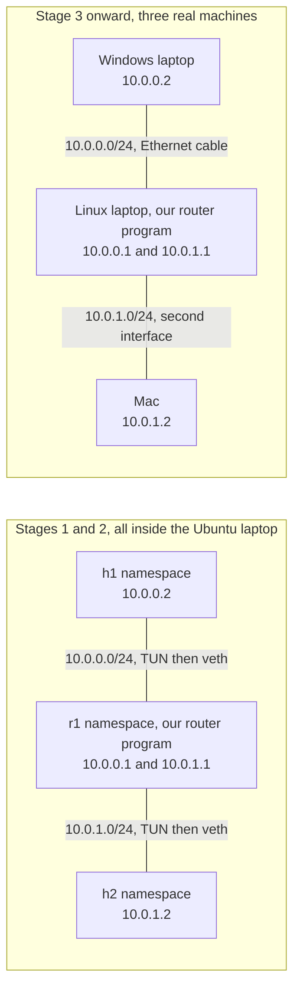
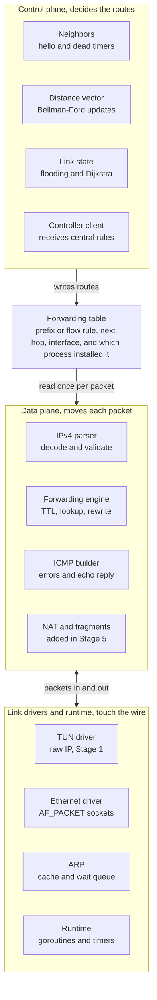
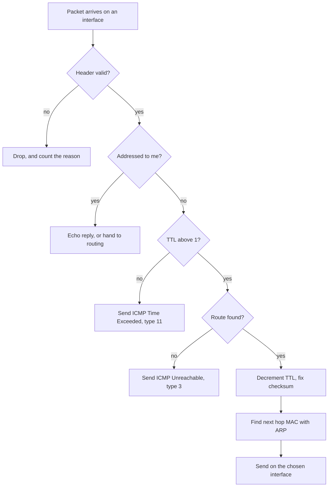
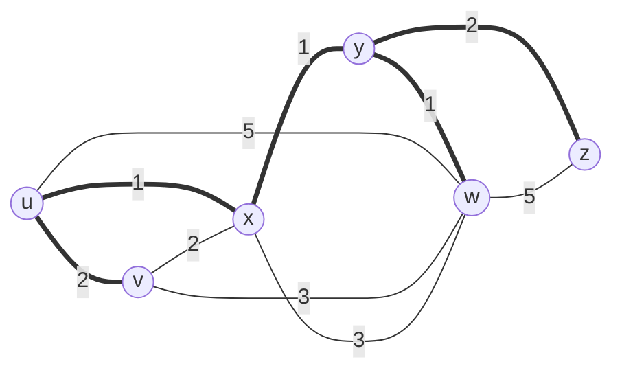

# Software Router Project Plan

Nov 8, 2026 · Obi Akubue

## What we are building

We are building `goodnews`, a working IPv4 router in Go on the Ubuntu laptop, so packets from real machines pass through code we wrote. The goal is understanding of Chapters 4 and 5 of Kurose and Ross. Speed is not a goal.

The design rests on one idea. The routing process writes to a forwarding table and the forwarding loop reads from it, and that table is the boundary between the control plane and the data plane.

Every stage ends with something visible in `ping`, `traceroute` or Wireshark. You can stop after any stage and still have a working result. Stage 1 now has an implementation and automated tests; its privileged networking exit tests remain a separate gate. See `docs/verification.md` for the actual verification results.

An agent writes the code and Obi designs, reads, customizes and tears it apart. The router is therefore built to be observed and changed, much as Wireshark makes the network visible.

## Lab topology

The router sits between two subnets, so every packet between the hosts must cross our code.

Rehearsing in namespaces keeps the experiment off the laptop's real network. Logical names, addresses and routes carry over to the physical lab; driver, device and namespace attachments change within the same config schema.

In Stage 1, each TUN device lives in its host namespace, not the router namespace. The router temporarily enters each host namespace on a locked thread to attach a file descriptor, then restores its own namespace. Host transmission becomes a descriptor read; a descriptor write injects a packet into the host. The `.1` router addresses exist only in Go. Stage 2 replaces these TUN attachments with veth Ethernet interfaces in the router namespace.

## Requirements

Each requirement has a test you can watch, so done is never a matter of opinion. The chapter column uses the Kurose and Ross numbering, where ARP is in the link layer chapter.

| ID | The router must | Stage | Chapter | How we prove it |
| --- | --- | --- | --- | --- |
| R1 | Read and write raw IP packets on two interfaces | 1 | 4 | tcpdump shows the packet entering and leaving |
| R2 | Check version, header length and checksum, and drop bad packets | 1 | 4 | A corrupted test packet raises the drop counter |
| R3 | Decrement TTL and recompute the checksum | 1 | 4 | Wireshark shows TTL one lower and a valid checksum |
| R4 | Choose routes by longest prefix match on CIDR prefixes | 1 | 4 | Unit tests with overlapping /8, /16 and /24 routes |
| R5 | Answer ping sent to its own addresses | 1 | 5 | `ping 10.0.0.1` gets replies |
| R6 | Send ICMP Time Exceeded when TTL reaches zero | 1 | 5 | `traceroute` lists the router as a hop |
| R7 | Send ICMP Destination Unreachable when no route matches | 1 | 5 | Ping to an unrouted address reports it |
| R8 | Parse and build Ethernet frames | 2 | 6 | Wireshark decodes every frame cleanly |
| R9 | Resolve next hops with ARP, with a cache and a queue for waiting packets | 2 | 6 | First ping triggers ARP, later pings use the cache |
| R10 | Forward between two physical laptops | 3 | 4 | `traceroute` from the Mac lists our router |
| R11 | Discover neighbors and detect their failure with hello messages | 4 | 5 | Stopping a router makes neighbors declare it dead |
| R12 | Build routes with distance vector | 4 | 5 | Tables match the textbook's six router example |
| R13 | Build routes with link state flooding and Dijkstra | 4 | 5 | Same topology database on every router, tables match hand work |
| R14 | Route around a failed link | 4 | 5 | Continuous ping shows a measurable gap, then recovers |
| R15 | Fragment packets too large for a link, and honor Don't Fragment | 5 | 4 | Large ping across a small MTU link arrives whole |
| R16 | Translate addresses with a NAT table | 5 | 4 | Outside capture shows only the router's address |
| R17 | Forward by match and action rules in a flow table | 6 | 4 | Rules on port or protocol steer traffic differently |
| R18 | Accept rules from one central controller | 6 | 5 | Routers run no routing process and traffic still flows |

Four constraints apply to every stage.

- **The kernel stays out.** `net.ipv4.ip_forward` is 0 and router interfaces hold no IP addresses, so any forwarding we see is ours.
- **One config format.** The same file describes namespaces and physical laptops.
- **Every drop has a reason.** Each drop is counted and logged, because a silent drop is the hardest bug here.
- **Go standard library plus x/sys/unix only.** Every byte of parsing stays visible, with no packet library such as gopacket doing the interesting work.

### Observability and customization

| ID | The router must | Stage | How we prove it |
| --- | --- | --- | --- |
| R19 | Log one trace record per packet with interface, addresses, TTL before and after, every matching prefix, the winner, and the action or drop reason | 1 | One ping can be followed start to finish in the trace |
| R20 | Log each algorithm step, with Dijkstra iterations in the textbook's step table layout and every distance vector update | 4 | Output compares line by line with hand work |
| R21 | Offer `goodnews show` to display the forwarding table, ARP cache, neighbors, link state database and counters | 1 | Each command answers on a running router |
| R22 | Provide `badnews`, a tool that changes link cost, link state, delay, loss and corruption at runtime | 2 | Impairments affect ping in Stage 2; Stage 4 cost changes alter routes with no restart |
| R23 | Include a packet crafting tool and write a pcap file per interface | 1 | A crafted packet appears in Wireshark and in the trace |
| R24 | Export traces and counters as JSON lines | 1 | A file loads into PostgreSQL and answers a query |
| R25 | Provide switches that disable protections, such as TTL decrement, checksum checks and poisoned reverse | 1 | Turning one off produces the failure it prevents |
| R26 | Accept routing algorithms as plugins chosen in config, each taking neighbor events and returning routes | 4 | A new algorithm runs with no change to forwarding code |
| R27 | Stay readable, with comments naming the textbook concept and functions named after the decision flow | All | Obi can trace a packet through the code unaided |

## Components

The router is one Go process per router, in three layers that meet at the forwarding table.

Nothing in the data plane knows which routing algorithm is running. That is why link state, distance vector and a central controller can replace each other without touching the forwarding code. The routing goroutine builds a new table and swaps it in with atomic.Pointer, so forwarding never waits.

| Component | File | Job | Stage | Requirements |
| --- | --- | --- | --- | --- |
| Runtime | `main.go` | Runs a goroutine per interface plus timers, owns counters and logs | 1 | All |
| Config loader | `config.go` | Reads interfaces, addresses and starting routes | 1 | R1, R10 |
| TUN driver | `drivers/tun.go` | Reads and writes raw IP packets | 1 | R1 |
| IPv4 parser | `ipv4.go` | Decodes headers and computes checksums | 1 | R2, R3 |
| Forwarding table | `fib.go` | Stores routes, answers lookups, swaps in new versions atomically | 1 | R4, R17 |
| Forwarding engine | `forward.go` | Runs the per packet decision flow | 1 | R3, R10 |
| ICMP builder | `icmp.go` | Creates echo replies and error messages | 1 | R5, R6, R7 |
| Ethernet driver | `drivers/ethernet.go` | Sends and receives frames with raw sockets | 2 | R8 |
| ARP | `arp.go` | Maps next hop IPs to MAC addresses | 2 | R9 |
| Neighbors | `neighbors.go` | Sends hellos and detects dead routers | 4 | R11, R14 |
| Distance vector | `dv.go` | Exchanges vectors and applies Bellman-Ford | 4 | R12 |
| Link state | `ls.go` | Floods link state and runs Dijkstra | 4 | R13 |
| Fragmenter and NAT | `frag.go`, `nat.go` | Splits large packets and rewrites addresses | 5 | R15, R16 |
| Controller | `controller.go` | Computes rules centrally and pushes them out | 6 | R17, R18 |
| Lab scripts | `lab/` | Builds namespaces and cables, runs the exit tests | 1 | All |

The implemented command line program is `goodnews`, which runs the router and answers `goodnews show` queries while it runs. A second program, `badnews`, is planned for Stage 2 and is not implemented yet. Its proposed commands include `badnews link y-x cost 60` for the textbook's bad news example and `badnews clear` to reset impairments. These are future interfaces; cost changes become routing inputs in Stage 4.

Stage 1 already offers fault experiments using crafted malformed packets, TTL expiry, missing routes, protection switches and stopping the router. `docs/stage1-experiments.md` documents those commands and their expected observations. A future `badnews` could also demonstrate delay, loss and link failure in a TUN lab, but Stage 1 currently has no runtime impairment controls.

`goodnews dashboard` adds a read-only terminal view of topology, counters, the forwarding table and packet history. It discovers a running router through its configuration, or opens a saved run with `--run`. Scrolling back restores the selected packet's recorded table and counters. New runs save a manifest, full FIB versions and event-linked counter snapshots; older logs remain readable with unrecorded state labeled unavailable. `docs/dashboard.md` explains live monitoring, replay and navigation in Fish and Bash.

## What happens to each packet

This flow is the forwarding engine, and Stage 1 is mostly writing it.

The ICMP and drop exits are where error messages come from. Every traceroute you have ever run was produced by real routers taking the TTL exit. In Stage 1 the ARP step does not exist yet, because TUN carries IP packets with no Ethernet frame around them.

## Control plane view

In Stage 4 each node is a separate router process in its own namespace, and each line is a virtual cable with the cost set in config.

Thick lines are the least cost tree from router u, and each number is a link cost. Routers exchange hellos and routes as ordinary IP packets using protocol number 253, which is reserved for experiments. OSPF does the same with protocol 89, and you will see both as packets in Wireshark. Each router computes only its own tree, so the thick links are router u's view and router z would highlight different ones.

## Build stages

Ethernet and ARP come before routing protocols. Routers need real links between them before they can exchange routes, and Ethernet over virtual cables provides those links.

1. **Forwarding over TUN, in namespaces (R1 to R7).** Exit test is real `traceroute` from one namespace to the other showing our router as a hop.
2. **Ethernet and ARP over virtual cables (R8, R9).** Exit test is the same ping, now with ARP visible in Wireshark.
3. **Physical laptops (R10).** Exit test is `tracert` on Windows and `traceroute` on the Mac both crossing our router.
4. **Routing protocols (R11 to R14).** Six router processes form the textbook's example graph with routers u through z. Exit test is that router u reaches v at cost 2, x at 1, y at 2, w at 3 and z at 4, with everything except v leaving via x. Then repeat with other graphs worked by hand.
5. **Fragmentation and NAT (R15, R16).** Exit test is a large ping across a small MTU link, and a host behind our router reaching the Internet.
6. **Central controller (R17, R18).** Exit test is stopping every routing process, then starting one controller that restores traffic.

## How to learn from it

The working habit is to write down a prediction before each run, then check it against the trace and Wireshark. These experiments are the starting set, and the results listed are what we expect to see.

| Experiment | The change | What we expect to see |
| --- | --- | --- |
| Flood | Send every packet out every interface but the arrival one | Copies multiply until TTL ends them |
| Random neighbor | Pick any neighbor as next hop | Packets wander and some expire on the way |
| Always first neighbor | Ignore the destination's direction | Routers point at each other and `traceroute` repeats hops |
| Hop count only | Ignore link costs | u sends to w directly at cost 5, not via x and y at cost 3 |
| Load based costs | Set cost from queue length | Routes flip back and forth, as in the textbook's oscillation example |
| No TTL decrement | Switch off R3 inside a routing loop | A packet circles until the loop is broken |
| No poisoned reverse | Switch it off and raise a link cost | Distances count upward slowly |

A later experiment makes `badnews` turn a router into a liar, as in `badnews router y advertise cost 0`. We expect traffic to be pulled toward y and black-holed, and comparing how far the lie spreads under distance vector and link state shows the robustness difference the textbook describes.

## Implementation decisions and stage gates

Build and review small working checkpoints, starting with Stage 1. Each lab explains setup commands, what they do, expected results, inspection and cleanup. Predict a packet's behavior before the experiment, compare the trace and capture, and change one decision before advancing. Reading implementation code is optional follow-up rather than a prerequisite. `docs/stage1.md` provides the hands-on guide. Later-stage formats are finalized before their own implementation, rather than blocking the first router.

- [x] NAT target: prove translation between the two isolated subnets first. Internet access is an optional extension.
- [x] TUN setup: persistent host-side TUNs, opened using a locked-thread namespace switch with mandatory restoration. No TUN namespace move is needed.
- [x] Stage 1 kernel isolation: forwarding is zero in all three lab namespaces; logical router addresses are never installed in the kernel. Setup disables mutable checksum/segmentation offloads on host TUNs. NetworkManager cannot manage these namespace-local devices; physical-port exclusion is a Stage 3 gate.
- [x] Stage 1 edge cases: suppress ICMP errors about errors and noninitial fragments; reject broadcast, multicast and options with reasons; forward existing transit fragments but reject fragmented local delivery; report DF/MTU errors and count non-DF fragmentation as not implemented.
- [x] Config schema: versioned JSON using the Go standard library. `lab/stage1.json` is the example. Interfaces carry logical names, addresses, MTUs and device attachments; routes carry prefix, interface and optional next hop; observability and protections have separate sections. Unknown fields and invalid or duplicate values are rejected.
- [x] Stage 1 observability: one terminal JSONL record per ingress packet, correlated generated-packet records, JSONL counter snapshots, and raw-IP pcaps per interface. `goodnews show` uses read-only HTTP under `/v1/` over an owner-only filesystem Unix socket. Future subsystem views explicitly report not enabled.
- [x] Stage 1 test harness: Go 1.27.3, standard library plus pinned x/sys. Unit/race/vet/fuzz checks are unprivileged; `lab/acceptance.py` runs networking checks as root. Setup needs CAP_NET_ADMIN, namespace switching CAP_SYS_ADMIN, and crafting CAP_NET_RAW. Crafted bytes use AF_PACKET rather than AF_INET to preserve invalid checksums.
- [ ] Stage 1 empirical gate: run the TUN/corruption/namespace restoration and full ping/traceroute acceptance on the privileged Ubuntu host. Record results in `docs/verification.md`; no passing network result is claimed until this runs.
- [ ] Stage 2: validate AF_PACKET over veth; define ARP cache expiry, retries and bounded pending queues. Add `badnews` impairment controls and a clear operation. Cost changes become routing inputs in Stage 4.
- [ ] Stage 3: configure physical ports without kernel addresses, exclude them from NetworkManager, disable relevant offloads, and record settings for restoration.
- [ ] Stage 4: specify protocol 253 messages, timers, sequence numbers, aging, DV/LS selection and a statically registered Go routing-plugin interface before implementation. Do not use dynamic shared-library loading.
- [ ] Stage 5: specify NAT transports, checksum updates, state expiry and fragmentation interaction before implementation.
- [ ] Stage 6: specify flow matches, actions, priorities and replacement behavior. Use a separate management connection so reaching the controller does not depend on installed data-plane routes.

## Open decisions and later projects

- [x] Stage 3 design: use built-in Ethernet plus a USB Ethernet adapter. Confirm device names and adapter readiness at the Stage 3 gate.
- [x] Windows and Mac are available as lab hosts for the planned physical stage.
- [ ] Optional exercise, rewrite longest prefix match or Dijkstra by hand against the agent's tests
- [ ] Decide whether to write the BGP speaker later in Go or Ruby

Two later projects build on this one. The first is IP addressing and DHCP, where our router hands the Windows laptop its address, mask and gateway. The second is a small BGP speaker that opens a session with an FRR router and reads real AS paths.
